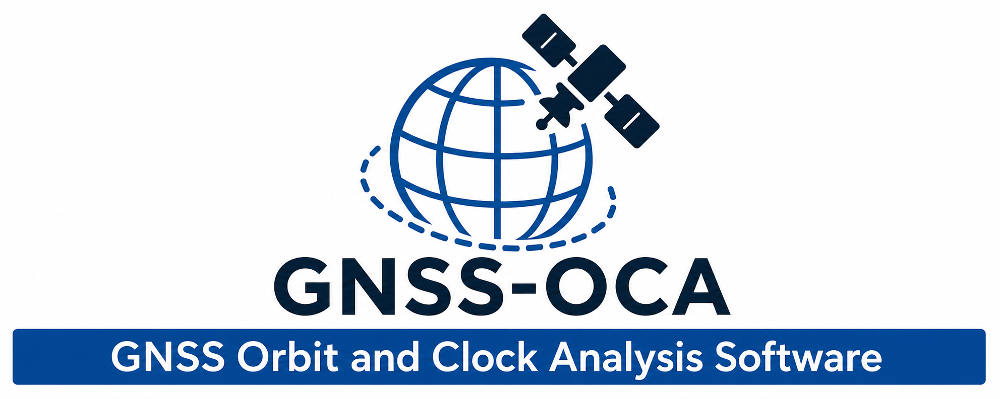

<p align="center">
  
</p>

# GNSS-OCA: An open-source software for GNSS Orbit and Clock Products analysis 

GNSS-OCA is an open-source software package developed for the analysis, comparison, and quality assessment of GNSS orbit and clock products.

The software provides a graphical user interface (GUI) for downloading, processing, and evaluating SP3 orbit and CLK clock products, antenna calibration files (ATX), and related GNSS datasets.

---

## Features

### Product Download

* Multi-center GNSS product download
* Support for:

  * CODE
  * ESA
  * GFZ
  * CNES
  * JPL
  * MIT
  * IGS
  * WHU
  * WUM
  * HUS
  * and other analysis centers
 
### Availability module
  * Evaluate the completeness of orbit (SP3) or clock (CLK) products, both at the constellation level and the individual satellite level
 
### Comparison Orbit & Clock Products
  * Compare GNSS orbit and clock products from different Analysis Centers or processing strategies by automatically aligning common epochs and supporting different sampling intervals.
  * Provide multi-GNSS quality assessment for GPS, GLONASS, Galileo, BeiDou, QZSS, and IRNSS, generating per-satellite and constellation-level RMS/STD statistics.
  * Orbit comparison reports satellite position differences in the Radial, Along-track, and Cross-track (RAC) frame, while clock comparison reports satellite clock differences with optional Radial Corrected Clock (Rclk) and eclipse (penumbra/umbra) identification.

### Day-boundary discontinuity analysis
  * Evaluates continuity between consecutive daily GNSS products by comparing the end of day N and the beginning of day N+1, enabling detection of orbit and clock discontinuities across daily solution boundaries.
  * Supports both orbit (SP3) and clock (CLK) products, automatically aligning epochs and handling different sampling intervals to ensure a consistent comparison between consecutive files.
  * Reports day-boundary discontinuities using RAC components for orbits and clock differences (including optional Radial Corrected Clock, Rclk) for clocks, with per-satellite and constellation-level statistics for GPS, GLONASS, Galileo, BeiDou, QZSS, and IRNSS.

### Overlapping Hadamard Variance analysis
  * Evaluates the frequency stability of GNSS satellite clock products using the Overlapping Hadamard Variance (OHV), a widely used metric for characterizing long-term clock noise and stability.
  * Supports multi-GNSS clock analysis for GPS, GLONASS, Galileo, BeiDou, QZSS, and IRNSS, with optional outlier detection and removal using a robust Median Absolute Deviation (MAD) approach before variance estimation.
  * Generates per-satellite OHV statistics for user-defined smoothing times, together with satellite metadata (SVN/block information), constellation summaries, and optional flagging of satellites with incomplete clock records.

---

## Installation

GNSS-OCA is a cross-platform application and can be installed on **Windows**, **Linux**, and **macOS** using a Conda environment.

### 1. Install Miniconda

Before installing GNSS-OCA, install **Miniconda**, which provides the Conda package manager used to create an isolated environment for all software dependencies.

Download Miniconda from:

https://www.anaconda.com/download/success

### Windows Users (Important)

After installing Miniconda, ensure that Conda is available from the command line.

Open **Command Prompt** and test:

```bash
conda --version
```

If the command is not recognized, you need to add Conda to the system **PATH**.

Typical Miniconda installation paths are:

```text
C:\Users\<USERNAME>\miniconda3
C:\Users\<USERNAME>\miniconda3\Scripts
C:\Users\<USERNAME>\miniconda3\Library\bin
```

Add these directories to the Windows **Environment Variables → PATH**.

Alternatively, open the **Anaconda Prompt**, which automatically configures the Conda environment.

Verify installation:

```bash
conda --version
```

A version number should be displayed.

### Linux and macOS Users

After installing Miniconda, open a terminal and verify:

```bash
conda --version
```

If Conda is not found, initialize your shell:

```bash
conda init
```

Then restart the terminal.

---

### 2. Install dependencies and GNSS-OCA software
Once Miniconda is installed and Conda is available from your terminal (Command Prompt, PowerShell, Terminal, or Anaconda Prompt), run the following commands to install and start GNSS-OCA.

```
# Clone repository or directly download from GitHub page below.
git clone https://github.com/husduman/GNSS-OCA.git
cd GNSS-OCA

# Create and activate Conda environment
conda env create -f environment.yml
conda activate gnss-oca

# Install GNSS-OCA
pip install -e .

# Launch GNSS-OCA
gnss-oca
```

---

## Authors
  * Huseyin Duman, Ph.D.
  * Sermet Ogutcu, Ph.D.
  * Salih Alcay, Ph.D.

---

## Citation

If you use GNSS-OCA in scientific research, please cite the software using the following information:
  * citation here

---

## License

This project is distributed under the MIT License.

---

## Acknowledgements

The development of GNSS-OCA has benefited from research activities in GNSS orbit and clock analysis, precise positioning, geodesy, and Earth observation studies.
